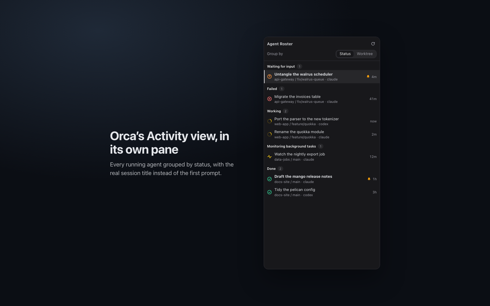
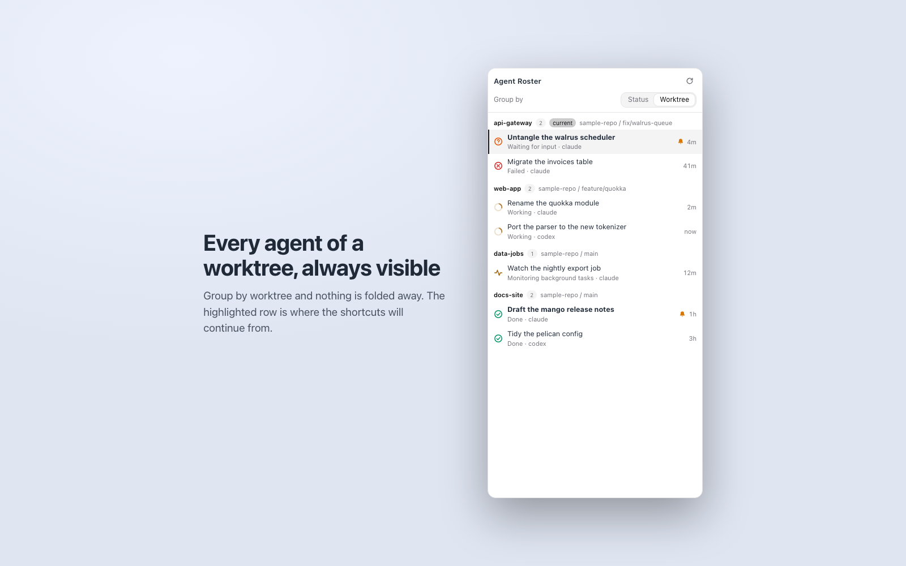

# Agent Roster

Orca's Activity view in its own sidebar pane, with real session titles and shortcuts to cycle between agents.

Agent Roster is a plugin for the [Orca](https://github.com/stablyai/orca) desktop IDE. It lists every running agent in the right sidebar, grouped the way Orca's Activity view groups them, labelled with the session title you see on the terminal tab (not the first prompt). Two shortcuts jump to the previous or next agent, from anywhere in Orca.



## What it does

- A right-sidebar panel with one row per running agent: status glyph, session title, `worktree / branch`, agent type and the time since its last update. Click a row to switch to that agent's terminal.
- The same status model and ordering as the Activity view: needs-you first, then working, then finished. See [Status legend](#status-legend).
- A **Group by** switch in the panel header: **Status** (default) or **Worktree**. In Worktree mode every group is always expanded and lists every visible agent of its worktree (finished sub-agents that Orca folds away stay hidden unless `showChildAgents` is on), and the worktree you are in carries a "current" pill.

  
- Two global shortcuts, previous and next agent, that call `orca terminal switch` for you. The row the shortcuts will continue from is highlighted in the panel.
- A small status-bar summary such as `2 working · 1 waiting`. It is hidden while no agent is running.
- A roster too large for one panel update (several hundred agents) is cut to its first rows, and the panel says "Showing N of M agents". The shortcuts still walk every agent.

## Install

```sh
orca plugin install balakumardev/orca-agent-roster
```

Orca shows what the plugin asks for and needs your approval before it runs. Then open the panel from the right sidebar (it is called **Agent Roster**).

Requires Orca 1.4.258 or newer (`engines.orca` is `>=1.4.258`).

## Shortcuts

| Action | macOS | Windows and Linux | Command id |
| --- | --- | --- | --- |
| Previous agent | `Cmd+Shift+;` | `Ctrl+Shift+;` | `agent-roster.prev` |
| Next agent | `Cmd+Shift+'` | `Ctrl+Shift+'` | `agent-roster.next` |

In the manifest the chords are `Mod+Shift+Semicolon` and `Mod+Shift+Quote`, both with `when: "global"`. Neither is used by one of Orca's built-in shortcuts. The commands are titled "Agent Roster: Previous agent" and "Agent Roster: Next agent". **Tested on macOS; Linux and Windows are untested.** The "Windows and Linux" column follows from `Mod` meaning Ctrl there, not from a run on those systems.

How the walk works:

- A press moves one step from the agent you are on. The step order is the panel's order (Status mode) or worktree by worktree (see `cycleOrder` below), and it wraps around at both ends.
- If you have moved somewhere else by hand, the next press starts fresh in the worktree you are in: **next** goes to its first agent, **previous** to its last one.
- Quick presses walk one steady list. For about two and a half seconds after a press the order is frozen, so a status change mid-burst cannot make the walk skip or repeat an agent.
- If the agent you were on disappears in the middle of a burst of presses, the walk continues from the place it had: **next** goes to the first agent after that place, **previous** to the nearest one before it. A click on a row that was not in the walked list starts the walk again, from the live order, at that row.
- The terminal for the agent is looked up when you press, not taken from the panel: each press (and each click) asks Orca for its terminal list first, so a terminal that Orca registered a moment after the agent appeared is found. If the pane is not listed yet, the plugin looks again up to three more times (about 0.25, 0.5 and 0.8 seconds later), then falls back to a terminal only when exactly one qualifies: the only other terminal of the same agent type in the same worktree, or the only terminal in the same tab. It never takes a terminal that belongs to another agent, and never guesses between two.
- An agent whose terminal still cannot be found is skipped: the press goes on to the next agent in the walk, at most once around the list. If no agent in the walk has a terminal, the press returns "no switchable agent" and the panel rows pick up their terminals on the next refresh.
- With no agent to go to, a press returns the message "Agent Roster: no agents to switch to", which Orca shows, and the plugin log notes it. If Orca refuses a switch, the plugin tries the next agent once; if that fails too, the press returns "could not switch" and the log has the reason.
- Every press has one budget of 24 seconds in total, time spent queued behind earlier presses included. When the Orca CLI is stuck, a press ends with "Orca did not answer in time" instead of hanging, presses queued behind it are dropped once their own budget is spent, and a press that Orca stopped waiting for is cancelled (its CLI call is killed).

**Known limit.** The shortcuts switch Orca to the agent's terminal, but Orca's built-in **Agents** list in the left sidebar keeps its own selected row and offers plugins no way to change it, so it can stay on the previous agent after a press. The highlight in this plugin's panel always shows where the shortcuts continue from.

### Remap the shortcuts

Orca reads user overrides from `~/.orca/keybindings.json`. The key for a plugin action is `plugin:<author>.<plugin id>/<command id>`, so for this plugin:

```json
{
  "version": 1,
  "keybindings": {
    "plugin:balakumardev.agent-roster/agent-roster.next": "Mod+Shift+Period",
    "plugin:balakumardev.agent-roster/agent-roster.prev": "Mod+Shift+Comma"
  }
}
```

A value is one chord string, an array of chord strings, or `null` / `false` to unbind the action. Per-platform overrides go under `"platforms": { "darwin": { ... } }` (also `linux` and `win32`) and win over the common section.

### If a shortcut says no terminal ...

A press can answer "no switchable agent, Orca lists no terminal for them right now", and a click on a row can say "Orca lists no terminal for this agent right now ... try again". It means Orca did not list a terminal for that agent when asked, even after looking again. The usual cause is timing: the agent is visible in Orca's left pane before its terminal is registered, and the same action works a moment later. A row Orca listed no terminal for at the last refresh is shown slightly dimmed, and it is still clickable.

- Press or click again after a second. The plugin re-reads the terminal list after a failed click and again shortly after any refresh that leaves an agent without one, so the row normally fixes itself.
- If it keeps happening for the same agent, open the plugin log (Orca's plugin logs). A failed lookup logs one line, `handle lookup`, with the pane's tab and leaf ids cut to 8 characters, whether the tab is in Orca's terminal list, how many terminals the worktree has, which agent identities they carry, and whether a retry or a fallback found it or all of them failed. The line never holds a title, a prompt or a terminal handle, so it is safe to paste into a bug report.
- A terminal Orca marks as orphaned (its process is gone) is never used.

## Status legend

Rows are grouped, and ordered within a group, by this rank (top is most urgent). The status is Orca's own verdict for each agent; Agent Roster only recomputes it, the way Orca does, when Orca reports none.

| Status | Panel label | Typical meaning |
| --- | --- | --- |
| waiting | Waiting for input | The agent asked you something and is waiting. |
| blocked | Blocked | The agent cannot continue on its own. |
| permission | Needs attention | The agent is waiting for a permission decision. |
| failed | Failed | The run ended in an error. |
| unconfirmed | Couldn't confirm | Orca could not confirm what the agent is doing. |
| working | Working | The agent is running a turn (animated spinner). |
| monitoring | Monitoring background tasks | The agent is watching background tasks. |
| interrupted | Interrupted | You stopped the agent. |
| unverifiable | No recent update | A working, blocked or waiting agent that has not reported for 30 minutes and whose terminal is still alive. |
| done | Done | The agent finished its turn. |
| idle | Idle | Nothing running. |

A bold title with a small bell means the agent has something unread. The time on the right is coarse, like the Activity view: `now`, `5m`, `3h`, `2d`; hover it for the exact time. After 30 minutes without an update, a working, blocked or waiting agent decays to "No recent update" (or to Idle once its terminal is gone), as in Orca. Orca's own verdict is used whenever it is present, which is the normal case. Only when it is missing does the plugin work the status out itself, and then a row owned by Orca's structured host never decays, because Orca exempts it (the flag is `structuredHostOwned` in `orca worktree ps --json`; it is documented here from Orca's code, not from a live row of that kind).

## Settings

Open the plugin's settings in Orca. The **Group by** switch in the panel header writes the first setting.

| Setting | Values | Default | What it does |
| --- | --- | --- | --- |
| `groupBy` | `status`, `worktree` | `status` | How the panel groups agents. |
| `cycleOrder` | `activity`, `projects` | `activity` | `activity` walks the panel's status order. `projects` walks worktree by worktree, then agent by agent, so repeated presses visit every agent of a worktree before leaving it. Worktrees come in the order Orca's sidebar uses by default (Recent: the most recently active worktree first, then by name). Not mirrored: the sidebar's grouping by project, and its other sort modes. |
| `skipFinished` | on / off | off | The shortcuts skip agents that are done, idle, interrupted or failed. |
| `showChildAgents` | on / off | off | Also show the finished sub-agents Orca folds away under their coordinator. A sub-agent that is still running is always listed, as in the Activity view, and carries a "sub-agent" tag. |

## How titles are chosen

Each row shows the first of these that is a real title:

1. The terminal's own title (the one on its tab): the real session title.
2. The agent's conversation name.
3. The task title.
4. The agent's display name.
5. Orca's own activity title, then the prompt text, each cut to 60 characters. The panel never uses a prompt while a real title exists.
6. The worktree name, then plain `Agent`.

Every source goes through the same checks. A title that is only the name of the worktree, folder, repo or product (or a shell name, or a path) counts as generic and is skipped. Spinner and bullet glyphs that agents put at the start of a title are removed, control characters turn into spaces, and invisible characters (soft hyphen, zero-width space, word joiner, byte-order mark and the bidi overrides that can disguise a title) are deleted. The joiners that belong to emoji sequences and Persian words are kept, and titles are shortened by whole characters as a reader sees them, so an emoji is never cut in half. The result is always drawn as plain text.

## Privacy

Everything stays on your machine. The plugin runs two read-only commands, `orca worktree ps --json` and `orca terminal list --json` (the second one again when you press a shortcut or click a row, and once more shortly after a refresh that leaves an agent without a terminal), and `orca terminal switch --terminal <handle>` when you press a shortcut or click a row. It makes no network requests, has no telemetry, and writes no files of its own; its four settings live in Orca's own settings store. The plugin log holds counts, timings and error reasons, and for a failed terminal lookup the first 8 characters of the pane's tab and leaf ids; the plugin's own log lines contain no session titles, prompts or terminal handles (titles are shown in the panel only).

This is a `trusted-worker` plugin: its code runs in a separate Node.js process with your user account's access, which Orca tells you at install time. It asks for three capabilities: `agent:read` (agent status events), `workspace:read` (the focused workspace and its terminals) and `settings:own` (its own four settings).

## Development

```sh
npm test               # unit tests, plain node:test (Node 22.18+ runs the TypeScript directly)
npm run test:orca      # the same suite plus the mount-worker test, via `orca plugin test .`
npm run validate       # orca plugin validate .
npm run typecheck      # tsc; needs .orca/types (see below)
npm run smoke          # read-only live check against your running Orca: prints counts only
```

- Layout: `src/model.ts` (status model, titles, grouping, pure), `src/cycle.ts` (the walk, pure), `src/resolve.ts` (finding the terminal for a pane from a fresh list: exact key, the two guarded fallbacks, the redacted log description; pure), `src/poller.ts` (single-flight refresh with debounce), `src/cli.ts` (the only code that runs the Orca CLI; it looks for the macOS app's binary first, then `orca` on the PATH, and kills the child on a timeout or an abort), `src/worker.ts` (commands, panel handlers, events, status bar), `panel/` (plain HTML, CSS and JS, no build step).
- `main` is `src/worker.ts`: Orca transpiles TypeScript itself, so there is no build step. The sources stay compatible with Node's type stripping (explicit `.ts` import extensions, no enums, `import type`).
- The data comes from `orca worktree ps --json` (agents and their activity, about 0.2 s measured) joined with `orca terminal list --json` (titles and terminal handles) on the pane key. The worker refreshes on agent and workspace events, debounced (400 ms, at most 2 s late), and every 30 s as a safety net.
- Platform: tested on macOS only. The PATH handling uses the platform's separator and the Windows PATH is left alone, but nothing has run on Linux or Windows.
- The panel loads its CSS and JS by relative URL, which works in the desktop app. A browser client of Orca would need those assets inlined into `panel/index.html`.
- The panel tests run the real `panel/panel.js` under `node:vm` against a small hand-written DOM (`test/fake-dom.ts`, parsed from the real `panel/index.html`) and a fake Orca bridge; the CLI tests start real child processes, but only throwaway shell scripts the tests write themselves.
- `.orca/types` holds Orca's plugin typings and is gitignored. Generate it with `orca plugin types .`.
- `npm run smoke -- --scan-repo` checks that no live session title appears in any file of the repository and prints counts only. Test fixtures are invented samples.
- Regenerate the screenshots with `node scripts/make-screenshots.mjs` (headless Chrome; set `CHROME` to use another binary). They render the real panel with invented data and a stubbed `window.orca`. `scripts/icon.svg` is the source of `icon.png`.

## License

MIT. See [LICENSE](LICENSE).
